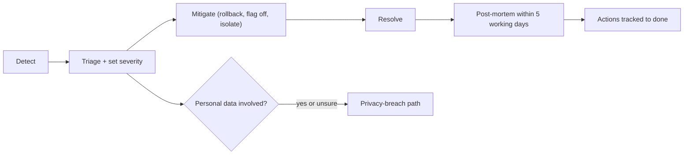
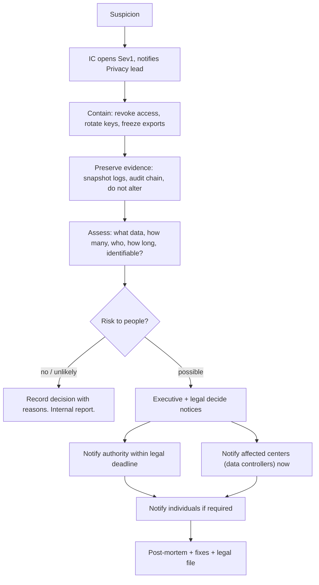

# 07 Incident Response

## Roles
| Role | Duty | Small-team note |
|---|---|---|
| Incident Commander (IC) | Runs the incident. Decides. Declares severity. | On-call engineer by default; hands off if overloaded |
| Ops engineer | Fixes. Runs the runbook. | Second engineer |
| Comms lead | Writes status updates and user notices | Product/ops lead |
| Privacy lead | Judges if personal or sensitive data is involved. Owns the breach path. | Named person; deputy named |
| Scribe | Keeps the timeline | Any available person |
| Executive contact | Decides on regulator and partner notices, with legal | Operator lead (Tech4Cancer assumed, GATE-OPERATOR) |
One person may hold two roles in Sev3. In Sev1 IC and Ops engineer must be different people.

## Severity
| Sev | Definition | Response | Update rhythm |
|---|---|---|---|
| Sev1 | Possible leak of sensitive data; data loss or corruption; audit gap; protected area fully down over 1 h; security compromise | Page now, 24x7. All hands needed. | Every 30 min |
| Sev2 | Protected area degraded or down under 1 h; public site down; backup/PITR failing; key workflow broken | Page now in business hours; night page if no workaround | Every 60 min |
| Sev3 | Minor degradation, workaround exists, single feature | Next business day | Daily |
| Sev4 | Cosmetic or request | Backlog | none |

## Lifecycle

First rule: stop the harm, then find the cause. Mitigate before root cause.

## Privacy-breach path
This path runs when personal data, link keys, or identifiers may have been exposed, or when sample-level data was shown to a role that should not see it. Because the portal should hold no direct identifiers (REQ-041, REQ-042), a re-identification risk or a wrongly shown record still counts. When unsure, treat as yes.

Clock: the clock starts when the operator becomes "aware". Write the awareness time in the timeline.

Legal notification timelines. NEEDS LEGAL REVIEW. UNVERIFIED in this research (no legal source fetched). Known from general knowledge, to be confirmed by counsel:
| Rule | Expected timeline | Status |
|---|---|---|
| EU GDPR Art. 33 and 34 | Authority within 72 h of awareness, if risk; individuals without undue delay if high risk; processor tells controller without undue delay | UNVERIFIED, applicable only if GDPR applies (e.g., EU region or EU data subjects) |
| Israel Privacy Protection Law and Data Security Regulations 2017 | Serious security incident: report to the Privacy Protection Authority; deadline and form to confirm. | UNVERIFIED, needs legal review; deadline not confirmed here |
| Israel health-information rules (Ministry of Health) | Unknown | UNVERIFIED |
| HIPAA Breach Notification Rule | Up to 60 days; only if the data is US PHI | UNVERIFIED, likely not applicable |
| Contractual: DPA, DTA/MTA with each center | Center and platform notice windows set by contract, often 24 to 72 h | Contracts not drafted yet (OPEN-A9-05) |
Working rule until counsel replies: notify the executive contact and legal within 4 h of awareness; notify affected centers within 24 h; treat 72 h as the outer limit for the authority notice.
Render as processor: Render's own incident notice duties and contact path are in the DPA (UNVERIFIED; task V-09).

## Comms templates (synthetic)
**Status update (internal chat)**
```
[SEV2] ARI-PST Portal protected area slow. Start 10:05 UTC. Impact: searches time out for some users. Mitigation: rolling back release a1b2c3d. IC: <name>. Next update: 11:00 UTC.
```
**Public status notice**
```
We have a problem with the researcher area. The public site works. We are fixing it. Next update in 60 minutes.
```
**User notice, resolved**
```
The researcher area works again since 11:20 UTC. Cause: a faulty release. No data was lost. Sorry for the trouble. We will publish a short review.
```
**Center notice, possible data exposure (draft, needs legal review)**
```
Subject: Security incident notice, ARI-PST Portal
We found at <UTC time> that <short factual description>. Data types affected: <list of field names, no values>. Number of records: <n>. Actions taken: <list>. What we ask of you: <list>. Next update: <time>. Contact: <role mailbox>.
```
**Authority notice**: legal counsel writes it. We supply facts: timeline, data types, counts, controls, mitigation.
Comms rules: facts only; no blame; no guess about cause until known; no personal data in any notice; one voice (comms lead).

## Blameless post-mortem
- Within 5 working days for Sev1/Sev2. Optional for Sev3.
- Format: summary, impact, timeline (UTC), detection, what went well, what went badly, root cause (5 whys), actions (owner, due date, ticket), SLO budget used.
- No names of blame. Say "the deploy step", not "Dan's mistake".
- Review meeting 45 min. Notes published to the team; sanitized copy to centers if they were affected.
- Action review at monthly metrics review. Overdue actions escalate to the tech lead.
