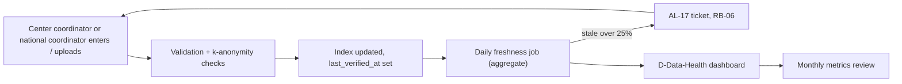

# 10 Operating Model After Launch

Addresses REQ-007, REQ-066, REQ-067 and the Doc §11 stale-data risk: an index that is out of date loses trust.

## Who does what (RACI-lite)
| Area | Owner (A) | Does the work (R) | Backup |
|---|---|---|---|
| Public site content (he and en) | Content lead | Non-technical editors via Git CMS; reviewer approves PR | Second editor |
| Index freshness and quality | `national_coordinator` | Center coordinators and the national coordinator | Deputy coordinator |
| Ingestion pipeline health | Tech lead | On-call engineer | Second engineer |
| User support (accounts, access, how-to) | Support owner (ops lead) | Support rota (coordinator office + engineer for escalation) | Tech lead |
| Access-request process | `committee_member` chair | Coordinator pre-check, committee | Deputy chair |
| Security and privacy | Privacy lead | Security lead + tech lead | Deputy |
| Releases and SLO | Tech lead | Engineers | Second engineer |
| Cost, vendors, contracts | Operator lead (GATE-OPERATOR assumed Tech4Cancer) | Ops lead | Legal |
No role is a single person without a named deputy.

## Content maintenance (public site)
- Editors use the CMS; every change is a PR with preview (synthetic/public content only). Reviewer checks facts, he/en parity, accessibility text, and that no personal data or identifiable story appears (patients and families page: consent rules, needs legal review).
- Cadence: News at least monthly; Infrastructure and Partners quarterly check; Privacy policy and terms yearly legal check.
- Alert: a page not updated in 12 months shows in a monthly report (ticket to the content lead).
- Broken links and accessibility: automated weekly crawl (axe + link check); failures create tickets.

## Index freshness (stale-data control)

- Freshness window: a record is "fresh" if `last_verified_at` is within 90 days (config, product to confirm).
- Quarterly "verify drive": coordinators confirm unchanged records with one click (bulk verify) so repeat value is shown to them (REQ-068).
- Availability changes (e.g. sample depleted) must be entered within 5 working days (target, product to confirm). Researchers see "last verified" next to counts.
- Center scorecard (counts, fresh ratio) goes to the steering committee each quarter. This is the social lever for freshness; the tech lever is the alert.
- Owner of freshness: national coordinator. SRE supplies the measure, not the fix.

## Support model
- Channels: one support mailbox (role address), in-app help link, FAQ in the portal. No patient data may be sent; the help page says so and the mailbox auto-reply repeats it. Staff who receive personal data by mistake delete it and tell the privacy lead (RB-03 light).
- Targets: first reply 1 business day; account lockout fix 4 business hours.
- Tiers: L1 coordinator office (how-to, accounts via admin workflow); L2 engineer (bugs); L3 tech lead.
- Support does not log in as users. Impersonation is not allowed.
- Tickets tagged: account, data-quality, request-process, bug, privacy. Privacy tag goes to the Privacy lead the same day.

## Metrics review (monthly, 60 min)
Agenda: SLO and budget; incidents and actions; alert hygiene; backup and drill status; freshness by center; cost vs plan; capacity triggers; vendor and dependency advisories; success metrics from REQ-066 (centers feeding, record count and field completeness, registered researchers and searches, requests and completion rate and time to delivery, share of coordinator-entered records, citations).
Attendees: tech lead, ops lead, national coordinator, privacy lead. Output: a one-page note and ticket list.
Quarterly: add steering committee view, drill results, risk register update. Yearly: vendor review, DR-4, DR-5, policy review (needs legal review for privacy parts).

## Handover to steady state
Before go-live: owners named, deputy named, on-call rota filled, runbooks rehearsed once, drills DR-1/2/3/6 passed, status page live, support mailbox live, monthly review booked for 12 months.
