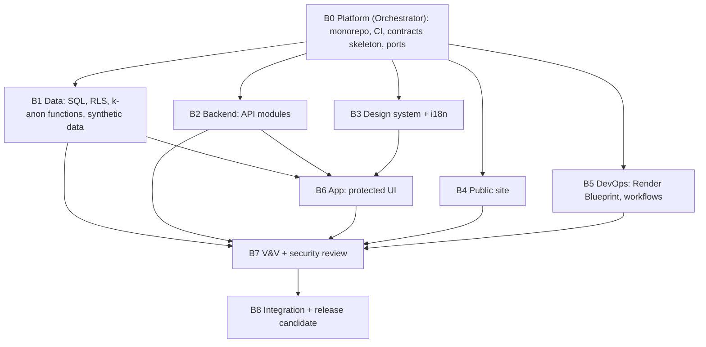

# Agent Runbook — build phase

How to run the multi-agent build for Phase 1. Use the same pattern as the plan: contract first, parallel agents, review, integrate.

## Rules
- Each agent owns folders. No two agents edit the same file.
- Contracts are the handoff: `packages/contracts` (OpenAPI), `db/migrations` (SQL), `packages/domain` (ports).
- Synthetic data only. No real data in any file or environment.
- Every change is a commit on a branch. CI must pass before merge.
- Agents write requests to `plan/requests/` instead of editing others' files.

## Build waves

| Wave | Agent | Owns | Done when |
|---|---|---|---|
| B0 | Orchestrator | root config, `packages/contracts`, `packages/domain` ports, CI | CI green on empty modules; arch test runs |
| B1 | Data | `db/`, `packages/synthetic-data` | Migrations apply; RLS and k-anon tests pass |
| B2 | Backend | `apps/api` | Contract tests pass; authz matrix passes |
| B3 | Design | `packages/design-system`, `packages/i18n` | Tokens, components, he/en, axe clean |
| B4 | Public site | `apps/public-site` | Pages, CMS config, Lighthouse budgets pass |
| B5 | DevOps | `infra/`, `.github/` | Blueprint valid; preview deploy works |
| B6 | App | `apps/web`, `packages/api-client` | Role flows work in Playwright, he + en |
| B7 | V&V | tests, `docs/evidence` | Test catalog green; privacy canaries pass |
| B8 | Orchestrator | everything | Exit criteria met |

## Handoff contracts
1. **OpenAPI → API and client.** Change the spec first. Regenerate the client. Spectral lint must pass.
2. **SQL → API adapters.** Migrations are forward-only, expand/contract.
3. **Domain ports → adapters.** Ports change by ADR only.
4. **Design tokens → UI.** Logical CSS properties only.

## Quality gates between waves
| Gate | Check |
|---|---|
| G1 | Lint, typecheck, unit tests, architecture test (domain imports no platform library) |
| G2 | OpenAPI lint, contract tests, migration dry-run on Postgres 16 |
| G3 | Authz matrix (every role × every endpoint), RLS tests, k-anonymity property tests |
| G4 | Privacy canaries: no identifier pattern in index, logs, analytics |
| G5 | a11y (axe), Lighthouse, e2e he + en |
| G6 | SAST, dependency, secret and IaC scans; SBOM |
| G7 | Release review against `plan/04-product-workflow/07-phase1-acceptance-checklist.md` |

## Re-running the plan process
1. Update `00-contract-pack.md` with new decisions.
2. Start agents in one turn, each with its folder and return rule.
3. Run R1 and R2 on the result.
4. Patch findings. Update the register and traceability matrix.
