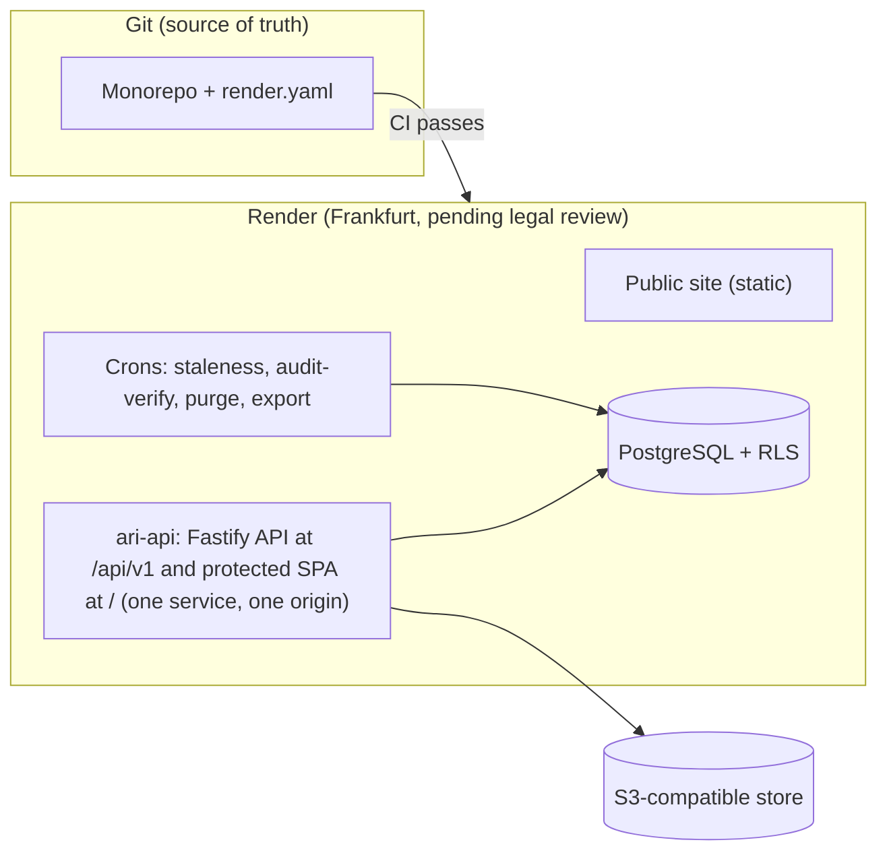

# ARI-PST Portal — Master Plan

Version 0.3 (plan complete, Phase 1 built). Date: 2026-11-13. Canonical fixes: `plan/11-integration/canonical-decisions.md`.
Review findings from R1 and R2 are patched in later. Status of each is in `plan/10-review/`.
Needs legal review: every legal and regulatory item in this plan.

## 1. Vision
One national digital asset for pediatric solid tumors, in two layers (REQ-001).
- **Public site:** shows the initiative. Hebrew (RTL) and English.
- **Protected area:** a searchable **index** of de-identified samples. Role-based. Governed access requests.

Core rule: tissue and identifying data stay in the medical centers. The portal holds an index, never identified data (REQ-002).
Goal: help researchers find samples, and cut the load on treating doctors (REQ-005, REQ-007).

## 2. Scope
| In Phase 1 (REQ-062) | Out of Phase 1 |
|---|---|
| Public site, he + en | Pathology scan viewer (Phase 2) |
| Login with MFA, 7 roles, permissions | Institutional SSO (Phase 2) |
| Index: Shaare Zedek + Madgam | Partner API (Phase 3) |
| Search, filters, k-anonymous counts | Analytics and AI (Phase 3) |
| Request flow, end to end | Genomic data (only an "available" flag) |
| Audit log, backup, restore | Real patient data, until `GATE-PROD-DATA` closes |

Phase 1 is built fully functional, but runs on **synthetic data only**.

## 3. Architecture on one page

- **Modular monolith.** Ten modules. Domain core imports no platform library. A test enforces this.
- **Contracts first.** OpenAPI 3.1 and SQL schema are the stable interface.
- **Privacy in the database.** Row-Level Security by center. External roles cannot read sample rows. They get counts through k-anonymity functions (k = 5).
- **Two-step coding.** Link keys never enter the portal.
- **Portable.** Standard stack only. Render-specific code lives in adapters. Base44 later is possible, not decided.

Details: `plan/01-architecture/`, `docs/architecture.md`. There is no separate `ari-app` (C-03, C-04).

## 4. Delivery model
| Event | Result |
|---|---|
| Pull request | Preview environment, synthetic data |
| Merge to `staging` | Auto-deploy to staging |
| Merge to `main` | Public site auto-deploys after CI. Protected area waits for a manual approval (two reviewers) |
| CI fails | No deploy |
Render has no built-in approval step (UNVERIFIED). The design uses a GitHub Environment plus Render deploy hooks. Owner must accept this (see §8).

## 5. Roadmap summary
| Phase | Content | Exit criterion (Doc §9) |
|---|---|---|
| 0 | Decisions, schema v1, collection protocols | Schema and platform approved |
| 1 | MVP and pilot | Access requests complete the full path to actual delivery |
| 2 | More centers, SSO, pathology, admin dashboard | At least 3 centers feed regularly |
| 3 | Sarcomas, partner API, analytics/AI | Basis for a data-driven clinical trial |
Sprint-level plan: `plan/ROADMAP.md`.

## 6. Team and roles
| Role | Who (assumed) |
|---|---|
| Product owner and clinical leads | ARI-PST leads (decide schema, committee rules) |
| Engineering (3–6) | Tech4Cancer (assumed operator, `GATE-OPERATOR`) |
| National research coordinator | Enters and maintains the index (funding TBD) |
| Access committee | Approves requests |
| Legal and privacy counsel | Reviews all legal items |
| Security reviewer | Threat-model gate, pen-test |
RACI: `plan/04-product-workflow/06-governance.md`.

## 7. Top 10 risks
| # | Risk | Mitigation |
|---|---|---|
| 1 | Re-identification from counts (Doc §11) | k = 5, merging, complementary suppression, query budgets, expert review |
| 2 | Legal status unclear (coded data, region, HIPAA) | Synthetic data until legal review; `GATE-PROD-DATA` |
| 3 | Stale index (Doc §11) | Coordinator entry, staleness cron, named owner |
| 4 | Doctors do not engage | Coordinator does entry; value screen for clinicians |
| 5 | Render region loss: recovery 8–24 h, data loss up to 24 h (`RISK-A9-01`) | Off-platform encrypted backup, DR drill |
| 6 | Render facts unverified (docs were unreachable) | Verify before go-live; list in `plan/07-devops-cicd/08-research-log.md` |
| 7 | No budget or staffing set (`GATE-BUDGET`) | Lean option; qualitative cost drivers |
| 8 | Platform lock-in | Ports, contract tests, export round trip in CI |
| 9 | Over-scope for a small team | Phase 1 cut line; no worker or Key Value |
| 10 | Centers do not join (Bilinson, Sheba) | Pilot success, then show value |

## 8. Decision gates (recommended default, deadline)
| Gate | Default | Needed by |
|---|---|---|
| `GATE-OPERATOR` Who operates | Tech4Cancer | Before Phase 1 contracts |
| `GATE-BUDGET` | Lean option | Phase 0 end |
| `GATE-SCHEMA` Schema v1 sign-off | §4 field list | Phase 0 end |
| `GATE-COMMITTEE` Composition, criteria | Criteria as configurable data | Before request flow UAT |
| `GATE-K` | k = 5 (owner chose) | Closed, revisit with expert review |
| `GATE-REGION` | Frankfurt (owner chose) | Before real data |
| `GATE-CLINICIAN-ID` | Coded record + link-out (owner chose) | Closed |
| `GATE-COMPLIANCE` | Not confirmed | Before real data |
| `GATE-GENOMICS` | Flag only | Phase 2 start |
| `GATE-PATHOLOGY` | Phase 2 | Phase 2 start |
| `GATE-INGEST` | Coordinator screen + CSV + staleness | Phase 1 start |
| `GATE-PROD-DATA` | Blocked | DPA, region control, export round trip, migration path, legal review, pen-test all done |
| Render approval gate | Accept GitHub Environment gate | Before first protected deploy |
| Logo | Concept B (app), C (public site); Shaare Zedek logo needs permission | Before public launch |

## 9. Budget drivers (qualitative)
Engineering time (largest). Render plans (Postgres with point-in-time recovery needs a paid tier). Off-platform backup bucket. Monitoring, pager and uptime vendors. Pen-test. Legal review. National coordinator salary. Hebrew editor and accessibility audit.

## 10. Quality bars
Each has measurable criteria in the plan: user friendly (`04`, `05`), reliable (`09`), secure and private (`02`), Apple-style design and brand (`05`), modular (`01`). Verification: `plan/08-vnv/`.

## 11. Next 5 actions
1. **Owner:** answer the open items: approval-gate design, logo concept, Shaare Zedek logo permission, committee composition.
2. **Clinical leads:** review schema v1, age bands, diagnosis list, usability targets.
3. **Legal counsel:** review the compliance map. First question: is coded or aggregated data "personal information"?
4. **Orchestrator:** R1 and R2 findings are patched into `canonical-decisions.md`. Phase 1 is built (see Status).
5. **Owner:** the free demo runs (Blueprint `ari-pst-demo` from `infra/render.free.yaml`, service `ari-demo-api-7teo`). Delete the broken hand-made service `ARI-PST`. For the paid production Blueprint (New → Blueprint, `main`, `render.yaml`) read `docs/deployment.md` sections 12 and 13 first.
6. **Orchestrator:** close the items in `docs/KNOWN-ISSUES.md`, then run UAT (`plan/08-vnv/04-validation-uat.md`).

## Status
This plan is a design-time record. The current system is described in [`../docs/README.md`](../docs/README.md).

| Item | State |
|---|---|
| Plan | Complete (waves 1 to 3). Authority: `11-integration/canonical-decisions.md`, then the code |
| Phase 1 build | Done, synthetic data only. PRs #1 and #7 merged. CI `ci-gate` green |
| Live demo | Render Blueprint `ari-pst-demo` (`infra/render.free.yaml`), service `ari-demo-api-7teo`, Frankfurt, manual deploy |
| Production Blueprint | `render.yaml` (paid plans), not applied |
| Google Cloud | Migration guide [`../docs/migration/google-cloud.md`](../docs/migration/google-cloud.md) |
| Open gaps and findings | [`../docs/KNOWN-ISSUES.md`](../docs/KNOWN-ISSUES.md), [`../docs/REVIEW-2026-11.md`](../docs/REVIEW-2026-11.md) |
| Real data | Blocked until `GATE-PROD-DATA` closes. Legal items need legal review |
