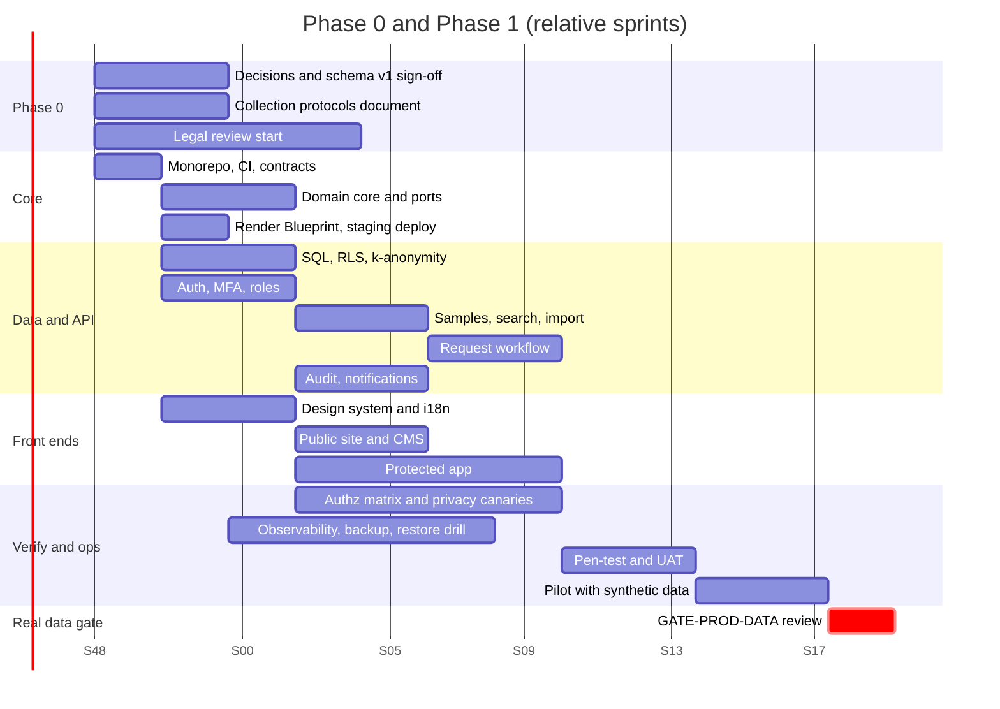

# ARI-PST Portal — Roadmap

Sprints are 2 weeks. Dates are relative (S1 = first sprint after the owner starts the build).
Assumes 3–6 engineers (ASSUMPTION-06). Estimates are rough and need the team's review.

## Streams
| Stream | Owner agent (build) | Phase 1 content |
|---|---|---|
| S-Core | Platform | Monorepo, CI, `render.yaml`, contracts, domain core |
| S-Data | Data | SQL, RLS, k-anonymity functions, import, synthetic data |
| S-API | Backend | Auth + MFA, roles, samples, search, requests, audit |
| S-App | Frontend | Protected app, design system, i18n |
| S-Public | Public site | Astro site, CMS, content |
| S-Verify | V&V | Test catalog, authz matrix, privacy canaries, UAT |
| S-Ops | SRE | Observability, backups, runbooks, drills |
| S-Gov | Owner and legal | Gates, legal review, committee, DPA |

## Gantt

## Sprint plan (Phase 1)
| Sprint | Goal | Key output |
|---|---|---|
| S1 | Foundations | Monorepo, CI gate, contracts, architecture tests, preview deploys |
| S2 | Data core | Migrations, RLS, role tests, synthetic data generator |
| S3 | Identity | Accounts, passkeys, TOTP, sessions, role checks |
| S4 | Index | Sample CRUD (coordinator), clinician center view, audit hash chain |
| S5 | Search | Facets, k-anonymous counts, differencing defenses |
| S6 | Ingestion | CSV/XLSX import with dry-run, staleness |
| S7 | Requests I | Cart, form, pre-check |
| S8 | Requests II | Committee vote, center coordination, MTA/DTA status, delivery |
| S9 | Public site | Pages, CMS, he/en, SEO, consent analytics |
| S10 | Hardening | Pen-test fixes, a11y, performance, restore drill |
| S11 | UAT | Users test; defect fixing |
| S12 | Release candidate | Exit-criteria review; go/no-go (synthetic data) |
Front end and public site run in parallel with S2–S8.

## Critical path
Contracts → SQL + RLS → k-anonymity → search → request workflow → UAT → gate review.
Longest external dependency: legal review and DPA (`GATE-PROD-DATA`). It runs parallel and can block go-live, not the build.

## Dependencies on people
| Item | Needed by sprint |
|---|---|
| Schema v1 sign-off | S2 |
| Committee composition | S7 |
| Center contacts for UAT (Shaare Zedek, Madgam) | S10 |
| Madgam export sample (synthetic mapping) | S6 |

## Later phases (outline)
- **Phase 2:** Ramban and other centers, institutional SSO, pathology viewer, admin dashboard, full bilingual. Exit: 3+ centers feed regularly.
- **Phase 3:** Sarcomas, partner API, analytics and AI layer. Exit: basis for a clinical trial.
